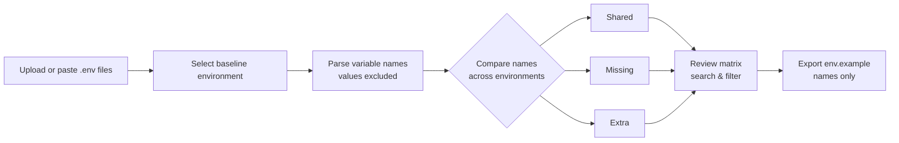

# EnvMirror

**Privacy-focused `.env` configuration comparison tool.**

[](https://github.com/mdabdulhamidk9/envmirror/actions/workflows/ci.yml)


**[Live Demo →](https://mdabdulhamidk9.github.io/envmirror/)**

EnvMirror is a privacy-focused `.env` configuration comparison tool that helps developers
identify configuration differences across environments without exposing variable values to
comparison results.

## Overview

Configuration drift between development, staging, and production is a common source of
deployments that fail — or worse, ship silently without the variables they need. Comparing
raw `.env` files by hand is tedious and usually means pasting secrets into diffs, shared
tools, or chat windows.

EnvMirror compares the variable **names** in up to three environment files (for example
Local, Staging, and Production) and reports which variables are shared, missing, or
extra relative to a baseline you choose. The comparison runs entirely in the browser, so
there is nothing to install, no account to create, and no server involved in the
comparison workflow. Developers who want consistent, auditable environment configuration
without sharing secret values are the primary audience.

## Live Demo

**https://mdabdulhamidk9.github.io/envmirror/**

## Key Features

- Compare environment variable **names** across Local, Staging, and Production inputs.
- Classify every variable relative to a selectable baseline: **Shared**, **Missing**,
  or **Extra**.
- Detect **duplicate** entries within an environment and count occurrences.
- Flag **invalid lines** (missing `=` separator or invalid variable name) by line number.
- **Search** the comparison matrix by variable name and **filter** by status.
- **Switch the baseline** (Local / Staging / Production) and watch classifications
  recalculate.
- Upload `.env` files or paste content; per-card clear and a global **Reset all**.
- Robust parser: comments, quoted values, `export` prefixes, empty values, CRLF/LF line
  endings, whitespace tolerance, very long lines.
- Export a clean **`env.example`**: variable names only, empty placeholder values,
  deduplicated, alphabetically sorted.
- Dark and light theme with system-preference detection and a persisted preference.
- Responsive interface for mobile, tablet, and desktop; keyboard-accessible controls.

## How It Works



1. Add or upload environment configuration files into the Local, Staging, and
   Production cards.
2. Select the baseline environment (Production by default).
3. EnvMirror parses the variable names and compares them across environments.
4. Review the matrix: shared variables present everywhere, variables missing from
   specific environments, and extras not present in the baseline.
5. Export the resulting `env.example` when you need a safe template.

## Privacy & Security

The privacy model is deliberately simple and fully client-side:

- **Raw values remain visible in their input editors** while you work — EnvMirror does
  not mask what you are editing.
- The parser extracts variable **names only**; values are excluded from the parsed
  result, so they cannot appear in comparison results, the matrix, or exports.
- Exported files contain variable names with empty placeholder values.
- All processing happens in your browser. The comparison workflow requires no backend
  and makes no intentional network requests with your content.
- The only persisted value is the theme preference, stored in `localStorage` under the
  `envmirror-theme` key.

Known limits, stated plainly: closing or resetting the page removes input from
application state, but browser JavaScript cannot guarantee secure erasure of memory.
EnvMirror cannot protect your data from browser extensions, compromised devices, or a
malicious browser environment. Treat the input editors like any file you have open on
your machine.

## Supported Input & Validation

- `.env` file uploads (`.env` and `.txt` files accepted) and pasted content.
- Maximum upload size: **512 KB**; larger files are rejected with a message.
- Non-text or unexpected file types (for example `.exe`) are rejected.
- CRLF, LF, and CR line endings are handled.
- Duplicate variable entries are detected and counted per environment.
- Invalid lines — no `=` separator or an invalid variable name — are reported with line
  numbers (never line content).
- Files that parse to zero variables (empty or comments-only) leave the card marked as
  empty.

## Tech Stack

| Technology | Purpose |
| --- | --- |
| React 19 | UI |
| TypeScript (strict) | Type safety |
| Vite 8 | Build tooling |
| Vitest 5 | Unit testing |
| Oxlint | Linting |
| GitHub Actions | CI and deployment |
| GitHub Pages | Hosting |

## Getting Started

Prerequisites: Node.js 22.12 or later (Node 24 or 26 also work — Vitest requires at
least 22.12) and npm.

```bash
git clone https://github.com/mdabdulhamidk9/envmirror.git
cd envmirror
npm ci
npm run dev
```

Vite prints a local development URL (by default `http://localhost:5173/envmirror/`) —
open it in your browser.

## Development Commands

| Command | Action |
| --- | --- |
| `npm run dev` | Start the Vite development server |
| `npm run lint` | Lint with Oxlint |
| `npm run test:run` | Run the Vitest unit suite once |
| `npm run build` | Type-check (`tsc -b`) and build for production |
| `npm run preview` | Serve the production build locally |

## Testing & Quality

The repository ships with a Vitest unit suite covering the parser, the comparison
engine, and the export generator, plus Playwright browser QA scripts in `scripts/`
(referenced in `docs/FINAL-QA-REPORT.md`). The CI workflow (`ci.yml`) runs lint, tests,
and the production build on every push to `main` and on pull requests. Current status
is visible on the badge at the top of this README.

## Deployment

- **Production URL:** https://mdabdulhamidk9.github.io/envmirror/
- Deployment workflow: `.github/workflows/deploy.yml` — builds and deploys
  **automatically on every push to `main`**; manual deploys are available via
  workflow dispatch in the Actions tab.
- Vite is configured with `base: '/envmirror/'` so all assets resolve under the
  repository subpath.
- Required repository setting: **Settings → Pages → Build and deployment → Source →
  "GitHub Actions"**.

## Project Structure

```
src/
  components/   React UI (presentation only)
  hooks/        useTheme, useEnvironments
  lib/          pure logic: env-parser, compare, export (+ unit tests)
  types/        shared TypeScript types
  styles/       design tokens & global CSS
scripts/        Playwright browser QA suites
docs/           QA reports
.github/        CI and deployment workflows
```

## Contributing

Contributions are welcome — see [CONTRIBUTING.md](CONTRIBUTING.md). In short: fork the
repository, create a feature branch, make focused changes, run `npm run lint`,
`npm run test:run`, and `npm run build`, then open a pull request.

## Security

Please do not publish sensitive details in public issues. See
[SECURITY.md](SECURITY.md) for what is in scope and how to report a vulnerability
responsibly.

## License

This project currently has **no LICENSE file** and therefore no explicit open-source
license; all rights are reserved by the author until one is chosen.
